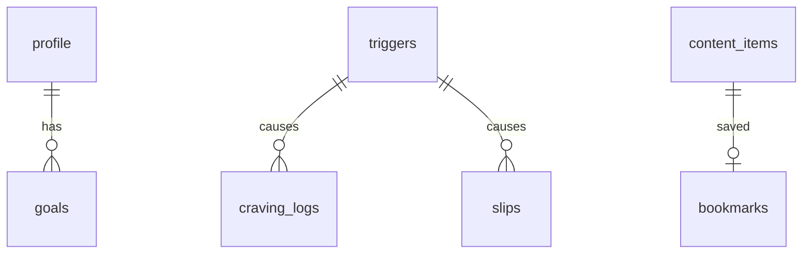

# 03 — Technical Architecture & Database Design

## 1. Stack (verified against project: Expo SDK 58, RN 0.88, Expo Router 58)
| Concern | Choice | Notes |
|---|---|---|
| Framework | Expo (managed, CNG) + TypeScript | `ios/`/`android/` generated, never hand-edited |
| Navigation | Expo Router (`src/app/`) | Tabs + stack/modals |
| Database | `expo-sqlite` | Install via `npx expo install expo-sqlite`; built into native runtime (dev build or Expo Go) |
| Settings/KV | SQLite `settings` table | Avoids extra dependency |
| Notifications | `expo-notifications` (local only) | `npx expo install expo-notifications` |
| Haptics | `expo-haptics` | Breathing/craving |
| Security | `expo-local-authentication` | Optional lock |
| Backup | `expo-file-system` + `expo-sharing` + `expo-document-picker` | JSON export/import |
| Animation | `react-native-reanimated` (already installed) | Breathing circle, confetti |
| Icons | `expo-symbols` / `expo-image` (existing) | |
| State | React context + hooks over SQLite (+ `zustand` optional) | Keep light |
| Validation | `zod` (optional) | Import validation |

> Before implementing, re-check API names at `https://docs.expo.dev/versions/v58.0.0/sdk/<module>/` (per AGENTS.md).

## 2. Layered Architecture
```
src/
  app/                    # routes only
    _layout.tsx           # SQLiteProvider + theme + onboarding gate
    (onboarding)/...      # welcome, quit-date, habits, reasons, triggers
    (tabs)/
      index.tsx           # Home dashboard
      progress.tsx        # Health timeline, achievements
      learn.tsx           # Lessons & articles
      journal.tsx         # Check-ins, insights
      settings.tsx
    craving.tsx           # modal: SOS flow
    slip.tsx              # modal: compassionate relapse flow
  components/             # UI primitives & feature widgets
  db/
    client.ts             # open DB, PRAGMAs
    migrations.ts         # versioned migrations via PRAGMA user_version
    seed/                 # bundled content (JSON/TS) loaded on first run
    repositories/         # profile, cravings, checkins, achievements, content
  domain/                 # pure logic: stats, milestones, health-timeline (unit-testable)
  hooks/                  # useProfile, useStats, useTicker
  constants/              # theme, copy
  i18n/
```
Rule: UI → hooks → repositories → SQLite. `domain/` has no React/DB imports.

## 3. Time & stats model (battery-safe)
Store only `quit_at` (UTC ms) and `last_relapse_at`. Elapsed = `now - quit_at`. A single 1 s (or 60 s) ticker runs only while a screen is focused. Derived:
- `cigsAvoided = floor(elapsedDays * cigsPerDay)` minus logged slips
- `moneySaved = cigsAvoided / packSize * packPrice`
- `lifeRegainedMin = cigsAvoided * 11` (commonly cited estimate; label as approximate)

## 4. Database schema (SQLite)
```sql
PRAGMA journal_mode = WAL;
PRAGMA foreign_keys = ON;

CREATE TABLE profile (
  id INTEGER PRIMARY KEY CHECK (id = 1),
  quit_at INTEGER NOT NULL,            -- epoch ms
  cigs_per_day REAL NOT NULL,
  pack_size INTEGER NOT NULL DEFAULT 20,
  pack_price REAL NOT NULL,
  currency TEXT NOT NULL DEFAULT 'USD',
  years_smoked REAL,
  approach TEXT NOT NULL DEFAULT 'cold_turkey', -- cold_turkey|gradual
  confidence INTEGER,                  -- 1-10 at onboarding
  created_at INTEGER NOT NULL
);

CREATE TABLE reasons (
  id INTEGER PRIMARY KEY AUTOINCREMENT,
  text TEXT NOT NULL,
  sort_order INTEGER NOT NULL DEFAULT 0,
  created_at INTEGER NOT NULL
);

CREATE TABLE triggers (
  id INTEGER PRIMARY KEY AUTOINCREMENT,
  key TEXT UNIQUE,                     -- predefined: stress, coffee, alcohol...
  label TEXT NOT NULL,
  is_custom INTEGER NOT NULL DEFAULT 0,
  is_active INTEGER NOT NULL DEFAULT 1,
  coping_plan TEXT                     -- if-then plan
);

CREATE TABLE craving_logs (
  id INTEGER PRIMARY KEY AUTOINCREMENT,
  started_at INTEGER NOT NULL,
  duration_sec INTEGER,
  intensity_before INTEGER,            -- 1-10
  intensity_after INTEGER,
  outcome TEXT NOT NULL CHECK (outcome IN ('resisted','smoked','abandoned')),
  trigger_id INTEGER REFERENCES triggers(id) ON DELETE SET NULL,
  tool_used TEXT,                      -- breathing|timer|distraction|reasons
  note TEXT
);
CREATE INDEX idx_craving_started ON craving_logs(started_at);

CREATE TABLE slips (
  id INTEGER PRIMARY KEY AUTOINCREMENT,
  occurred_at INTEGER NOT NULL,
  cigarettes INTEGER NOT NULL DEFAULT 1,
  trigger_id INTEGER REFERENCES triggers(id) ON DELETE SET NULL,
  reflection TEXT,
  reset_streak INTEGER NOT NULL DEFAULT 1
);

CREATE TABLE checkins (
  id INTEGER PRIMARY KEY AUTOINCREMENT,
  day TEXT NOT NULL UNIQUE,            -- local date YYYY-MM-DD
  mood INTEGER, stress INTEGER, confidence INTEGER,
  sleep_quality INTEGER,
  note TEXT,
  created_at INTEGER NOT NULL
);

CREATE TABLE thought_records (
  id INTEGER PRIMARY KEY AUTOINCREMENT,
  created_at INTEGER NOT NULL,
  situation TEXT, thought TEXT, emotion TEXT, reframe TEXT,
  belief_before INTEGER, belief_after INTEGER
);

CREATE TABLE goals (
  id INTEGER PRIMARY KEY AUTOINCREMENT,
  title TEXT NOT NULL,
  target_amount REAL NOT NULL,
  achieved_at INTEGER
);

CREATE TABLE achievements (
  key TEXT PRIMARY KEY,                -- refs content def
  unlocked_at INTEGER NOT NULL
);

CREATE TABLE support_contacts (
  id INTEGER PRIMARY KEY AUTOINCREMENT,
  name TEXT NOT NULL, phone TEXT NOT NULL
);

-- Bundled content (seeded, replaceable by app updates)
CREATE TABLE content_items (
  id TEXT PRIMARY KEY,
  type TEXT NOT NULL,                  -- quote|tip|lesson|article|exercise
  locale TEXT NOT NULL DEFAULT 'en',
  title TEXT, body TEXT NOT NULL,
  category TEXT, day_index INTEGER,    -- for 30-day programme
  author_or_source TEXT
);
CREATE INDEX idx_content_type ON content_items(type, locale);

CREATE TABLE bookmarks (
  content_id TEXT PRIMARY KEY REFERENCES content_items(id) ON DELETE CASCADE,
  created_at INTEGER NOT NULL
);

CREATE TABLE settings (
  key TEXT PRIMARY KEY, value TEXT NOT NULL
);
```

### ER overview


## 5. Migrations & seeding
- Version via `PRAGMA user_version`; ordered migration array run in a transaction (`withTransactionAsync`) in `SQLiteProvider onInit`.
- Seed predefined triggers and content on v1; on app update, upsert content by `id` (user tables untouched).
- Never destructive migrations without export-prompt.

## 6. Notifications (local)
Scheduled by milestone from `quit_at`; daily check-in reminder at user time; optional "high-risk hour" nudge derived from craving history. Rescheduled after relapse/reset. Quiet hours & max 3/day.

## 7. Security & privacy
No network permissions; optional biometric lock; excluded from cloud backup choice documented (Android `allowBackup` decision in `app.json`); export file is plaintext JSON — warn user.

## 8. Testing
- Unit: `domain/` (Jest) — stats, milestones, timezone/DST edge cases.
- DB: migration tests against in-memory DB.
- E2E: Maestro flows (onboarding, craving, slip, export/import).
- Gate: `npx expo lint`, `npx tsc --noEmit`, `npx expo-doctor`.

## 9. Performance budget
Cold start < 2 s; list screens use `FlashList`/`FlatList`; content queries paginated; images in WebP/SVG; no heavy libs; Hermes enabled; `expo-image` caching.
