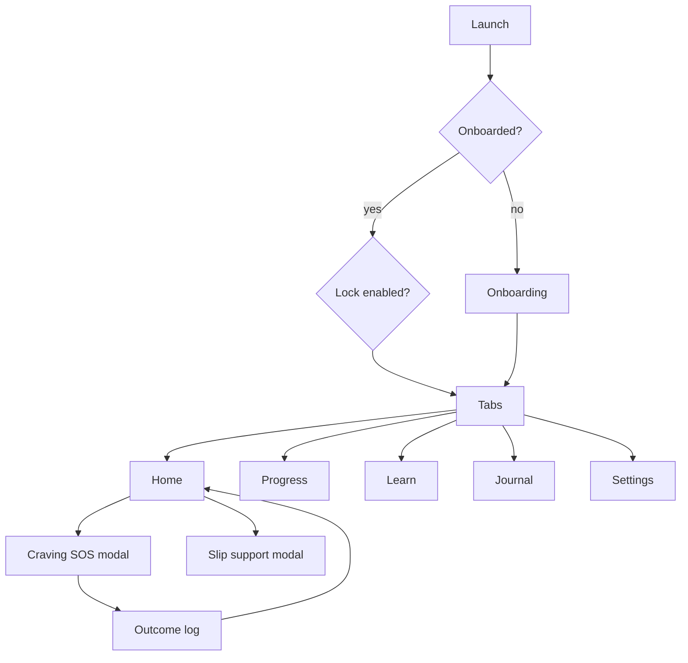

# 04 — UX, UI Design System & Content Strategy

## 1. Brand & tone
Warm, calm, non-judgemental, encouraging. Voice: "a supportive friend who respects your choices". Avoid fear-mongering, guilt, and medical commands.

## 2. Information Architecture

**Tabs:** Home · Progress · Learn · Journal · Settings. A persistent floating "Craving?" action on Home.

## 3. Key screens
1. **Welcome** – value prop, privacy promise ("Everything stays on your phone").
2. **Setup wizard** (4 short steps): quit date → habits & cost → reasons → triggers. Progress bar, skippable extras.
3. **Home** – hero smoke-free timer ring; 3 stat cards (money saved, cigs avoided, life regained); next milestone; daily quote; big SOS button; check-in prompt.
4. **Craving SOS** – full-screen calm gradient: reasons card → choose tool (Breathe / Ride the wave timer / Distract / Call someone) → outcome logging with celebratory feedback.
5. **Progress** – health timeline (vertical stepper, completed/next), badges grid, goals/rewards.
6. **Learn** – "Today's lesson" card, 30-day path, articles by category, bookmarks.
7. **Journal** – daily check-in, thought record, insights (heatmap, trigger bar chart, mood line).
8. **Slip flow** – "A slip is not failure" → what happened → trigger → commit/new plan → keep lifetime stats.
9. **Settings** – profile edit, notifications, lock, theme, text size, export/import, delete data, resources/quitlines, about/sources/disclaimer.

## 4. Design system
- **Colour (calm health palette):** Primary Teal `#0F9D8A`; Deep `#0B3C49`; Accent Amber `#F5A524` (rewards); Success `#2E9E5B`; Danger `#D64545`; Surface light `#F7FAF9`, dark `#0E1A1D`. All pairs ≥ 4.5:1 contrast; verify in tooling.
- **Typography:** system fonts (San Francisco/Roboto) for size and speed; scale 12/14/16/20/28/40; honour Dynamic Type.
- **Spacing:** 4-pt grid; radius 16 cards, 999 pills; soft shadows (elevation 1–3).
- **Components:** Button (primary/secondary/ghost), Card, StatTile, ProgressRing, Stepper, Slider (1–10), Chip, BottomSheet, EmptyState, Badge.
- **Motion:** reanimated 200–300 ms ease-out; breathing circle 4/7/8 s; respect Reduce Motion; haptics on milestone and breathing phases.
- **Dark mode:** first-class.
- **Icons:** SF Symbols (iOS) / equivalent via `expo-symbols`; fallback set for Android.

## 5. Accessibility checklist
Min touch target 44×44; labels/roles/hints on all controls; timers announced politely, not every second; no colour-only meaning; support 200% text; screen-reader friendly charts (text summary).

## 6. Content strategy (all bundled offline)
| Library | Qty (v1) | Purpose |
|---|---|---|
| Daily quotes/affirmations | 120 | Home rotation |
| Tips (4Ds, substitutes, routines) | 60 | Craving & home |
| 30-day lessons | 30 | CBT/MI/mindfulness micro-lessons |
| Articles | 20 | Withdrawal, sleep, weight, alcohol, stress, NRT overview |
| Craving exercises | 12 | Breathing, grounding, urge surfing scripts |
| Health milestones | 14 | Timeline |
| Slip messages | 15 | Compassionate copy |

### Health timeline (wording to verify vs. NHS/CDC/WHO before release)
20 min — heart rate and BP begin to drop · 12 h — blood carbon monoxide normalises · 2–12 wks — circulation and lung function improve · 1–9 mo — coughing and shortness of breath decrease · 1 yr — coronary heart disease risk about half that of a smoker · 5 yr — stroke risk drops substantially · 10 yr — lung-cancer death risk about half · 15 yr — heart disease risk near a non-smoker.

### Content rules
Reading level grade 6–8; ≤ 120 words per micro-lesson; cite source; clinician review; no cure/treatment claims; always suggest speaking to a healthcare professional about medication.

### Sample copy
- Craving: "This urge will pass. Most peak within 3–5 minutes. You don't have to fight it — just watch it rise and fall."
- Slip: "One cigarette doesn't erase your progress. You've still gone X days smoke-free overall. What did you learn?"
- Milestone: "24 hours! Your blood oxygen has recovered. That's your body thanking you."

## 7. Notifications copy guidelines
Max 3/day; opt-in; never include health data on lock screen unless user opts in; respect quiet hours.
