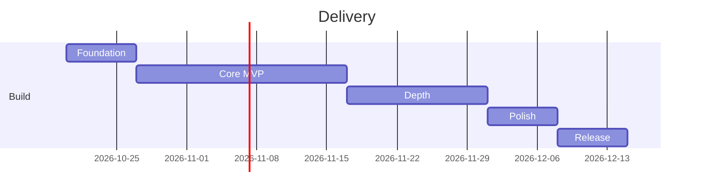

# 05 — Roadmap, QA Strategy, Release & Compliance

## 1. Delivery phases
| Phase | Scope | Exit criteria |
|---|---|---|
| 0. Foundation (wk 1) | Install deps, folder structure, theme, DB client + migrations, CI lint/tsc | App boots, DB v1 created, tests run |
| 1. Core MVP (wk 2–4) | Onboarding, Home dashboard, stats domain, milestones, craving SOS (timer + breathing + log), slip flow, settings basics, delete data | All P0 stories pass |
| 2. Depth (wk 5–6) | Check-ins, insights, thought records, 30-day lessons, articles, notifications, goals | P1 stories pass |
| 3. Polish (wk 7) | Accessibility audit, dark mode, haptics/animations, export/import, lock, perf tuning, store assets | WCAG AA, perf budget met |
| 4. Release (wk 8) | Beta (TestFlight/Play internal), clinician content review, store submission | Crash-free > 99.5% |

## 2. Task backlog (Phase 0–1 detail)
1. `npx expo install expo-sqlite expo-notifications expo-haptics expo-local-authentication expo-file-system expo-sharing expo-document-picker`
2. Create `src/db` (client, migrations, seed), `src/domain`, repositories.
3. Theme tokens + primitives (Button, Card, StatTile, ProgressRing).
4. Root layout: `SQLiteProvider`, onboarding gate.
5. Onboarding wizard → writes profile/reasons/triggers.
6. Home dashboard with `useStats`.
7. Craving modal (reasons, timer, breathing, outcome).
8. Slip modal; streak reset logic.
9. Milestone engine + achievements unlock.
10. Settings: edit profile, delete data.
11. Seed content JSON (quotes, tips, milestones).
12. Unit tests for domain; Maestro smoke flows.

## 3. QA strategy
| Level | Tool | Focus |
|---|---|---|
| Static | ESLint (`npx expo lint`), `tsc --noEmit` | Every PR |
| Unit | Jest | Stats math, milestones, DST/timezone, migrations |
| Integration | Jest + in-memory SQLite | Repositories |
| E2E | Maestro | Onboarding → craving → slip → export/import |
| Manual | Device matrix | Low-end Android, small iPhone, tablet, dark mode, large text |
| Accessibility | TalkBack/VoiceOver, contrast tools | Per release |
| Health check | `npx expo-doctor` | Dependency compatibility |

**Edge cases:** device clock change / timezone travel; quit date in future; app killed mid-craving; DB migration from older version; empty states; extreme values (0 cigs/day, huge price); import malformed JSON.

## 4. Build & release
- EAS profiles: `development`, `preview`, `production` (`bunx eas-cli`/`npx eas-cli@latest`).
- Versioning: semver; `runtimeVersion` policy `appVersion`; OTA via `eas update` only for JS/content-safe fixes (never DB-breaking).
- Store assets: icon, adaptive icon, splash, 6 screenshots, short/long description, keywords.
- Store listing: category Health & Fitness; privacy label "Data Not Collected"; age rating 12+/Teen (tobacco-reference).

## 5. Compliance checklist
- [ ] Medical disclaimer in onboarding and Settings.
- [ ] Quitline resources per region (e.g., US 1-800-QUIT-NOW, UK NHS 0300 123 1044 — verify numbers before release).
- [ ] Sources screen; clinician content sign-off.
- [ ] Privacy policy (statement: no data collected, local-only).
- [ ] Accessibility statement.
- [ ] Open-source license attributions screen.
- [ ] Apple/Google health-app policy review (no diagnostic claims).

## 6. Post-launch
Monitor store reviews; quarterly content refresh; v1.1+ ideas: home-screen widgets, Apple Health/Google Health Connect (opt-in), localisation (Sinhala, Tamil, Hindi, Spanish), gradual-reduction mode, encrypted backup, optional cloud sync (separate opt-in).

## 7. Risks & dependencies
Expo SDK 58 API changes (verify docs per module); content medical accuracy; scope creep (hold P2 for later); single-device data loss (mitigated by export reminders).

## 8. Definition of Done
Code reviewed · lint/tsc clean · unit tests pass · accessibility checked · works in airplane mode · no new network calls · docs updated.
