# 06 — System Design (Mermaid Diagrams)

## 1. System Context (C4 Level 1)
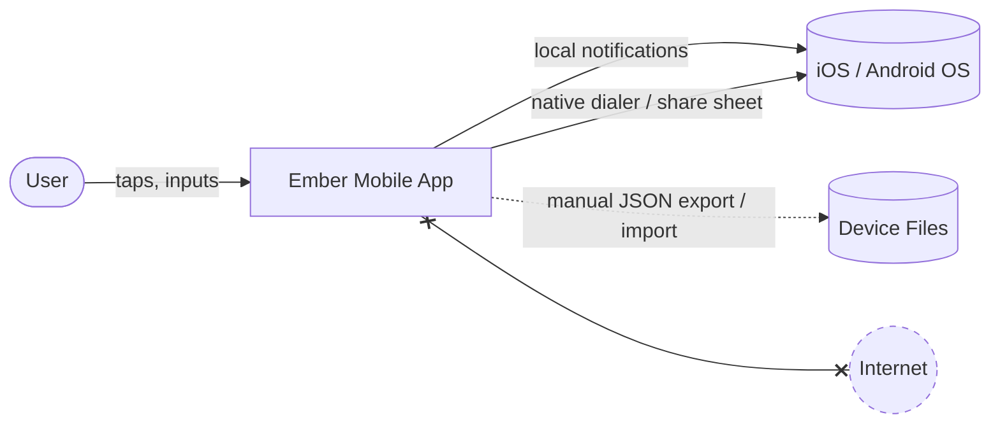
The app has no network dependency; the Internet node is shown to make "no connection" explicit.

## 2. Container / Layer View (C4 Level 2)
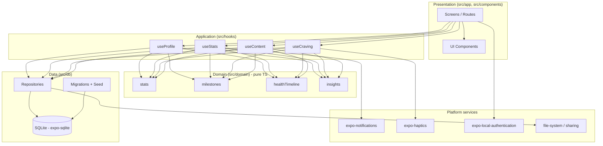

## 3. Navigation Map
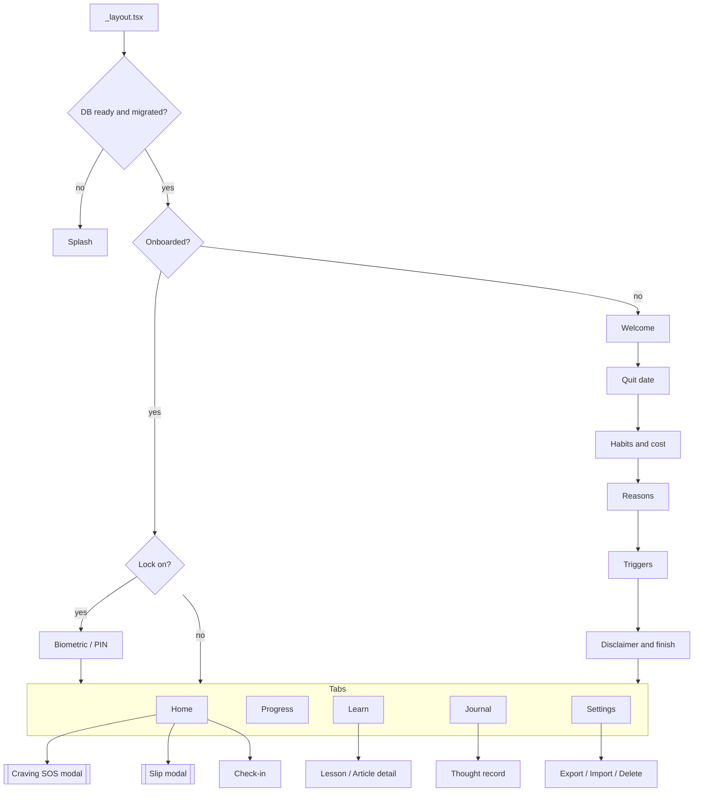

## 4. Sequence — App Cold Start
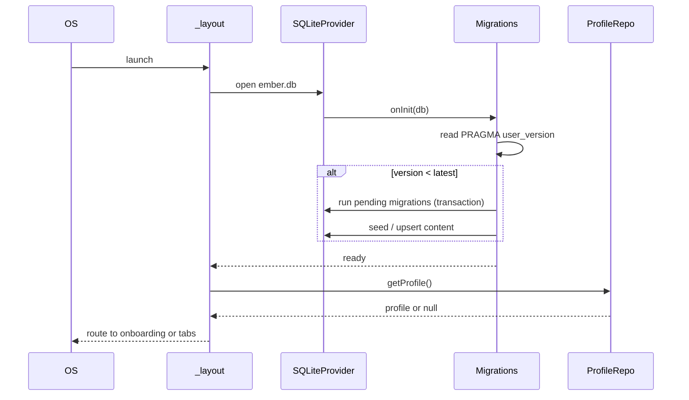

## 5. Sequence — Craving SOS
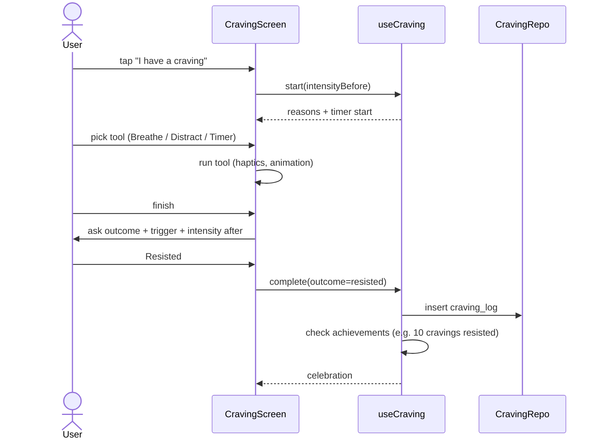

## 6. Sequence — Slip Flow
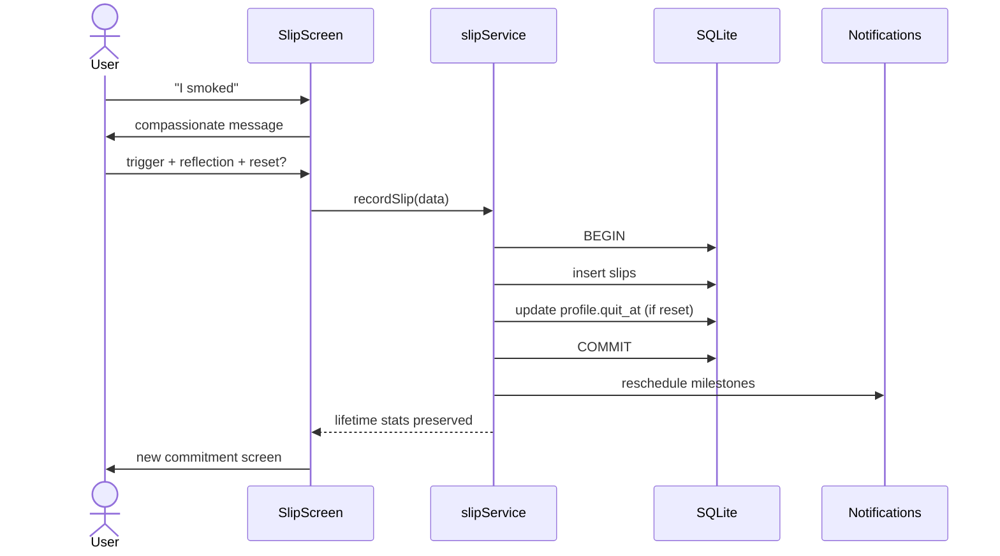

## 7. State Machine — Craving Session
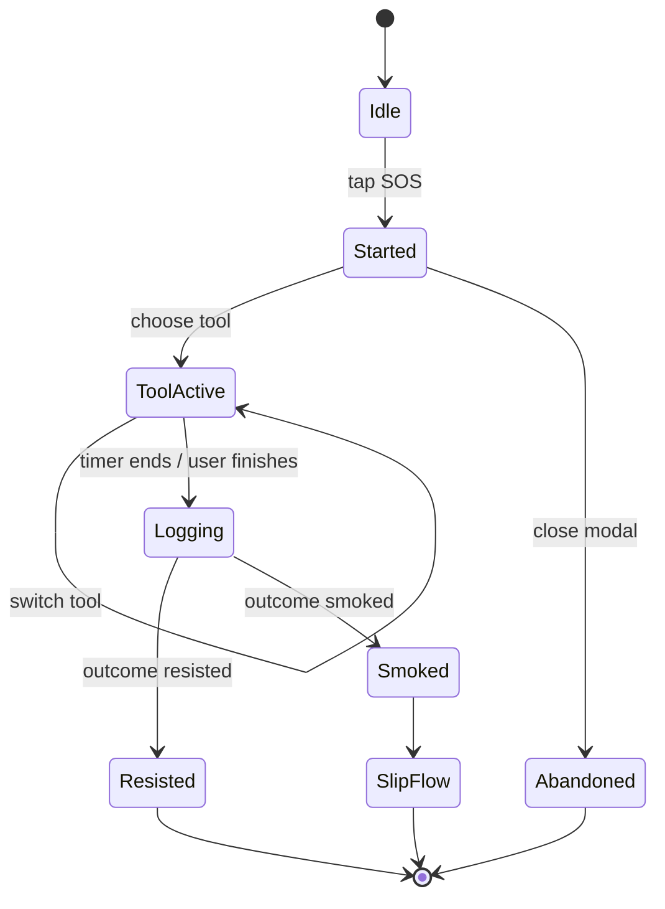

## 8. State Machine — User Journey Status
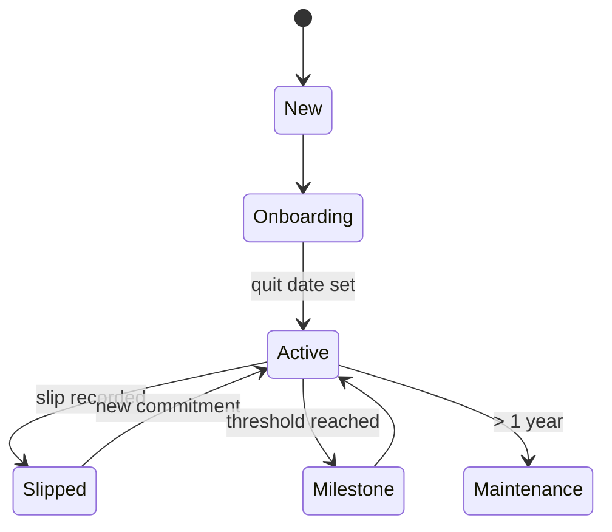

## 9. Class / Domain Model
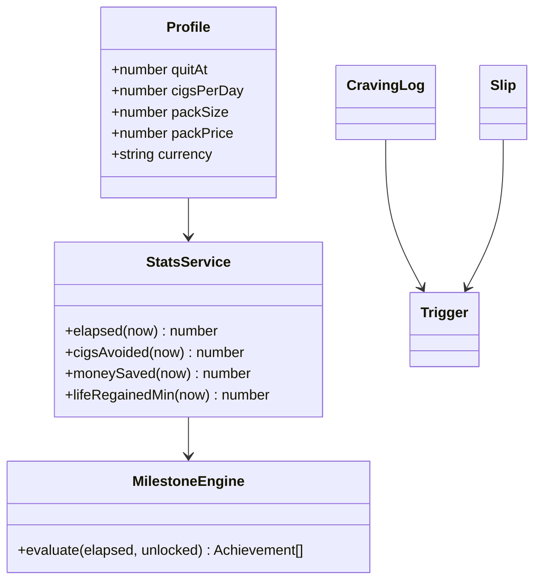

## 10. Data Flow — Backup Export / Import
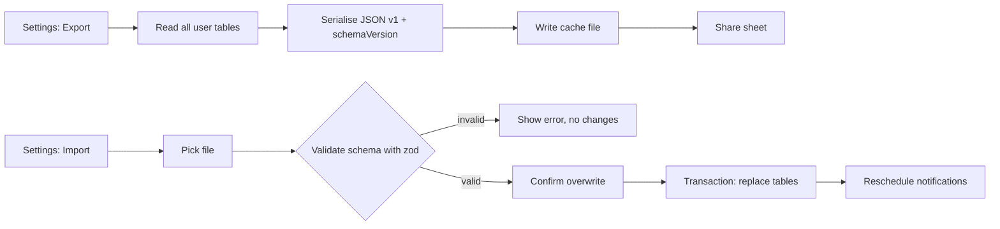

## 11. Deployment / Release Pipeline
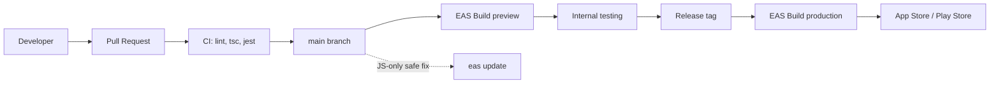
