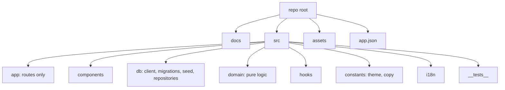
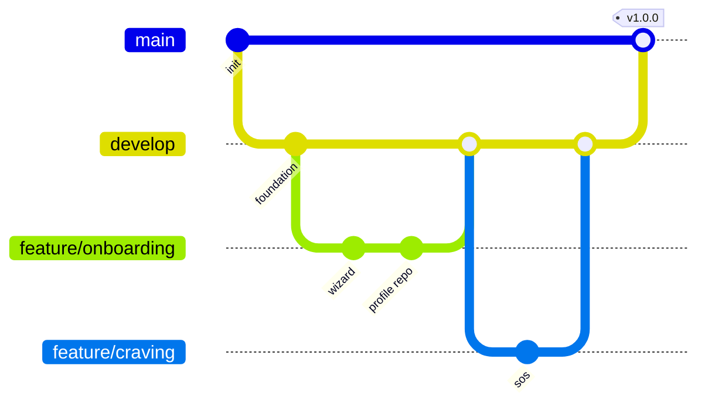

# 07 — Developer Guide & Engineering Standards

## 1. Prerequisites
Node LTS, Expo SDK 58 toolchain, Android Studio / Xcode (only for local native builds), EAS account. Package manager: the repo has `package-lock.json` → use **npm/npx**.

## 2. Setup
```bash
npm install
npx expo install expo-sqlite expo-notifications expo-haptics \
  expo-local-authentication expo-file-system expo-sharing expo-document-picker
npx expo start                 # dev server
npx expo run:android | run:ios # development build (native modules)
```
Always use `npx expo install` (never `npm add`) for Expo-compatible versions.

## 3. Quality gates (run before every PR)
```bash
npx expo lint
npx tsc --noEmit
npx expo-doctor
npm test
```

## 4. Repository structure

Dependency rule: `app → components/hooks → domain + db`. `domain` imports nothing from React, Expo, or db.

## 5. Coding standards
- TypeScript `strict`; no `any` (use `unknown` + narrowing).
- Functional components + hooks; one component per file; PascalCase components, camelCase functions, `kebab-case` route files.
- Parameterised SQL only (`?` placeholders) — never string-concatenate user input.
- Timestamps: epoch ms UTC in DB; local date strings (`YYYY-MM-DD`) only for check-in days.
- No `setInterval` per component for time; use a shared `useTicker` active only when screen focused.
- Styles via theme tokens; no hard-coded colours/sizes.
- All user-facing strings go through `i18n` keys.
- Errors: repositories throw typed `DbError`; UI shows friendly messages; never swallow silently.
- Accessibility props required on interactive elements (lint rule + review checklist).

## 6. Git workflow

- Branches: `main` (release), `develop`, `feature/*`, `fix/*`.
- Conventional Commits: `feat:`, `fix:`, `docs:`, `refactor:`, `test:`, `chore:`.
- PR needs: description, screenshots (UI), passing gates, 1 review.

## 7. Database practices
- Migrations are append-only, numbered, idempotent within a transaction; bump `PRAGMA user_version`.
- Example:
```ts
export const migrations: ((db: SQLiteDatabase) => Promise<void>)[] = [
  async (db) => { await db.execAsync(SCHEMA_V1); },
  // async (db) => { await db.execAsync('ALTER TABLE ...'); },
];
```
- Every migration has a test that upgrades from the previous schema.
- Seed content upserted by stable `id`.

## 8. Testing guidelines
| Layer | Target coverage | Notes |
|---|---|---|
| domain | ≥ 90% | table-driven tests, fixed clock |
| repositories | ≥ 70% | in-memory DB |
| components | key flows | React Native Testing Library |
| E2E | critical paths | Maestro |

Inject a `Clock` (`() => number`) into domain functions to make time deterministic.

## 9. Performance checklist
Memoise list rows; `FlatList` with `getItemLayout` where possible; avoid re-render of ticker parent; lazy-load Learn content; images WebP; check bundle with `npx expo export`; profile on a low-end Android.

## 10. Security checklist
No network permissions in `app.json`; no analytics SDKs; biometric lock via `expo-local-authentication`; warn on plaintext export; validate imports; exclude DB from auto-backup if user opts out.

## 11. Definition of Ready / Done
- **Ready:** story has acceptance criteria, design reference, and test notes.
- **Done:** code + tests + a11y + docs updated + works in airplane mode + gates green.

## 12. Environment & config
`app.json`: name, slug, scheme, icon, splash, `plugins` (expo-router, expo-sqlite, expo-notifications), `android.permissions` minimal, `ios.infoPlist` Face ID usage string. EAS profiles in `eas.json`: `development` (internal, devClient), `preview` (internal), `production`.
