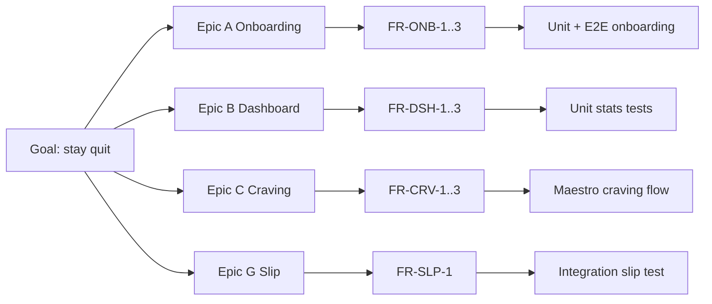
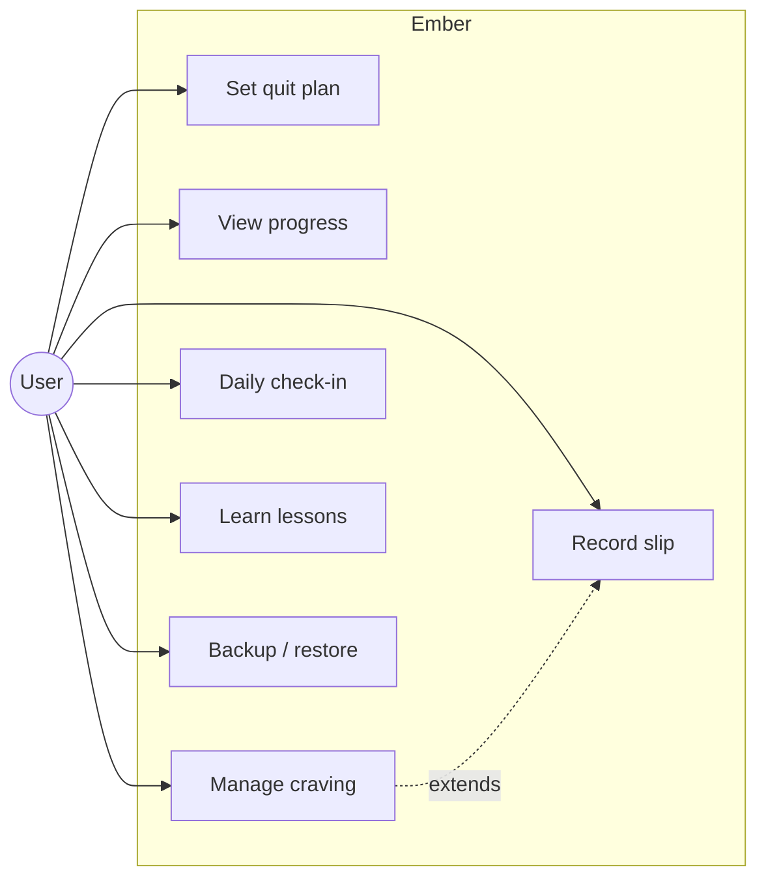
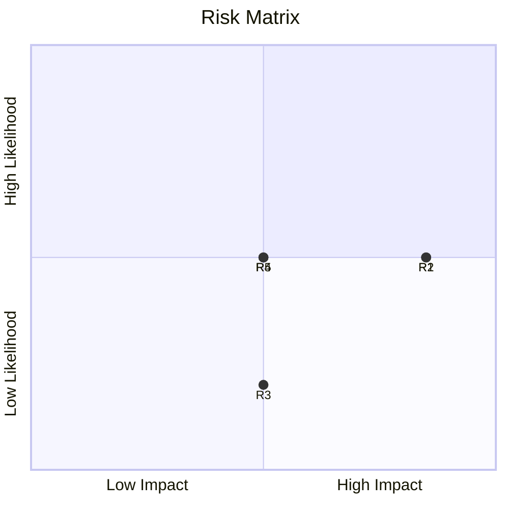

# 08 — Software Requirements Specification & Traceability

## 1. Functional Requirements (SRS)
Format: `FR-<area>-<n>` · Priority MoSCoW · Verification: T=Test, D=Demo, I=Inspection.

| ID | Requirement | PRD | Pri | Ver |
|---|---|---|---|---|
| FR-ONB-1 | The system shall let the user set a quit date/time, including "now". | A1 | Must | T |
| FR-ONB-2 | The system shall capture cigarettes/day, pack size, price, currency. | A2 | Must | T |
| FR-ONB-3 | The system shall require ≥ 1 personal reason. | A3 | Must | T |
| FR-DSH-1 | The system shall display elapsed smoke-free time computed from `quit_at`. | B1 | Must | T |
| FR-DSH-2 | The system shall compute money saved, cigarettes avoided, life regained. | B2 | Must | T |
| FR-DSH-3 | The system shall show the next health milestone with countdown. | B3 | Must | T |
| FR-CRV-1 | The system shall provide a craving flow reachable within 2 taps from launch. | C1 | Must | D |
| FR-CRV-2 | The system shall provide a guided breathing exercise with haptics. | C3 | Must | D |
| FR-CRV-3 | The system shall log craving outcome, intensity, trigger. | C6 | Must | T |
| FR-SLP-1 | The system shall support recording a slip without deleting lifetime stats. | G1–G2 | Must | T |
| FR-CHK-1 | The system shall store one check-in per local day. | D1 | Should | T |
| FR-INS-1 | The system shall show craving frequency by hour/weekday. | D3 | Should | T |
| FR-LRN-1 | The system shall present a 30-day lesson path offline. | E1 | Should | D |
| FR-ACH-1 | The system shall unlock achievements at defined thresholds exactly once. | F1 | Must | T |
| FR-NTF-1 | The system shall schedule local milestone notifications (opt-in). | F3 | Should | T |
| FR-SEC-1 | The system shall optionally require biometric/PIN to open. | A6 | Should | D |
| FR-DAT-1 | The system shall export and import all user data as validated JSON. | H2 | Should | T |
| FR-DAT-2 | The system shall delete all user data on request. | H3 | Must | T |
| FR-INF-1 | The system shall display disclaimer, sources, quitline resources. | H4 | Must | I |

## 2. Non-Functional Requirements
| ID | Requirement | Target | Ver |
|---|---|---|---|
| NFR-PERF-1 | Cold start on mid-range Android | < 2 s | T |
| NFR-PERF-2 | UI frame rate | ≥ 55 fps | T |
| NFR-SIZE-1 | Install size | < 25 MB | I |
| NFR-OFF-1 | Full functionality in airplane mode | 100% | T |
| NFR-PRV-1 | Network permissions / outbound requests | none | I |
| NFR-A11Y-1 | WCAG 2.2 AA | pass | I |
| NFR-REL-1 | Crash-free sessions | > 99.5% | T |
| NFR-REL-2 | Data survives app update (migrations) | no loss | T |
| NFR-MNT-1 | Domain-layer coverage | ≥ 90% | T |

## 3. Acceptance Criteria (Gherkin examples)
```gherkin
Feature: Craving SOS
  Scenario: Resisting a craving
    Given I am on the Home screen
    When I tap "I have a craving"
    And I complete the breathing exercise
    And I log outcome "Resisted" with intensity 7
    Then a craving_log row exists with outcome "resisted"
    And my "resisted" counter increases by 1

Feature: Slip handling
  Scenario: Slip preserves lifetime stats
    Given I have been smoke-free for 10 days
    When I record a slip and choose to reset my streak
    Then my current streak is 0 days
    And my lifetime smoke-free days remain 10
```

## 4. Calculation Specifications
| Metric | Formula |
|---|---|
| elapsedMs | `now − quit_at` (min 0) |
| cigsAvoided | `floor(elapsedMs / 86 400 000 × cigs_per_day)` |
| moneySaved | `cigsAvoided / pack_size × pack_price` |
| lifeRegainedMin | `cigsAvoided × 11` (approximate; shown as estimate) |
| lifetimeDays | sum of smoke-free spans across all quit periods |

## 5. Traceability Matrix


## 6. Use Case Diagram


## 7. Risk Register
| ID | Risk | Likelihood | Impact | Mitigation | Owner |
|---|---|---|---|---|---|
| R1 | Inaccurate health claims | M | H | Clinician review, cite sources | Content |
| R2 | Local data loss | M | H | Export reminders | Dev |
| R3 | Clock/timezone manipulation | L | M | UTC storage, tests | Dev |
| R4 | Expo SDK breaking changes | M | M | Pin versions, read v58 docs | Dev |
| R5 | Notification fatigue | M | M | Caps, quiet hours | Product |



## 8. Glossary
| Term | Meaning |
|---|---|
| Craving | Short-lived urge to smoke |
| Slip | Smoking after quit date |
| Relapse | Return to regular smoking |
| Urge surfing | Observing a craving without acting |
| CBT / MI | Cognitive Behavioural Therapy / Motivational Interviewing |
| NRT | Nicotine replacement therapy |
