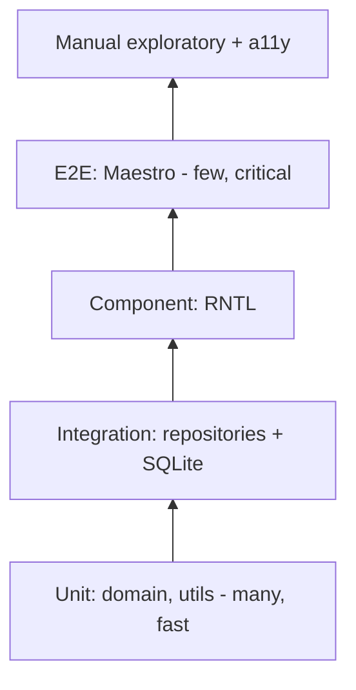
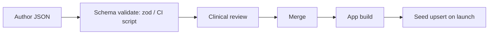
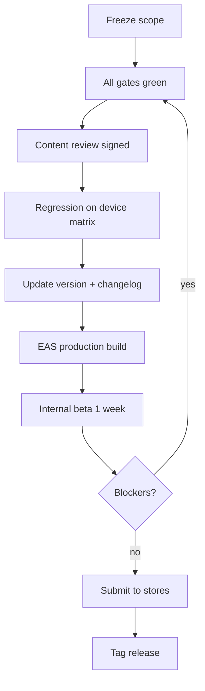

# 09 — Test Plan, Content Schema & Contribution Guide

## 1. Test Plan

### 1.1 Scope & Strategy


### 1.2 Test Cases (core)
| ID | Area | Scenario | Expected |
|---|---|---|---|
| TC-001 | Stats | quit_at = now | elapsed 0, money 0 |
| TC-002 | Stats | 10 cigs/day, 3.5 days | cigsAvoided = 35 |
| TC-003 | Stats | pack 20 @ 10.00, 40 avoided | money = 20.00 |
| TC-004 | Stats | future quit_at | elapsed clamped to 0 |
| TC-005 | Milestones | elapsed 24 h | 20-min and 24-h badges unlocked once |
| TC-006 | Milestones | re-evaluate | no duplicate unlock |
| TC-007 | Slip | reset = true | quit_at updated, lifetime preserved |
| TC-008 | DB | fresh install | user_version = latest, seed present |
| TC-009 | DB | upgrade v1→v2 | data intact |
| TC-010 | Check-in | two on same day | upsert, single row |
| TC-011 | Import | malformed JSON | rejected, no change |
| TC-012 | Delete | delete all | user tables empty, content intact |
| TC-013 | DST | quit across DST change | elapsed correct (UTC) |
| TC-014 | Offline | airplane mode full run | all features work |
| TC-015 | A11y | VoiceOver/TalkBack onboarding | all controls labelled |

### 1.3 Device Matrix
| Class | Examples |
|---|---|
| Low-end Android | Android 8–10, 2 GB RAM |
| Mid Android | Android 13, 6 GB |
| iPhone small | iPhone SE |
| iPhone current | latest iOS |
| Tablet | iPad / Android tablet |

### 1.4 Entry / Exit Criteria
Entry: build passes gates. Exit: 0 critical/high open bugs, all P0 cases pass, a11y audit signed off.

### 1.5 Bug Severity
| Sev | Definition | SLA |
|---|---|---|
| S1 | Crash, data loss | Immediate |
| S2 | Core flow broken | Before release |
| S3 | Minor defect | Next sprint |
| S4 | Cosmetic | Backlog |

## 2. Content Schema (bundled JSON)
Location: `src/db/seed/content/<type>.<locale>.json`

```json
{
  "schemaVersion": 1,
  "locale": "en",
  "items": [
    {
      "id": "lesson-day-003",
      "type": "lesson",
      "category": "cbt",
      "dayIndex": 3,
      "title": "Know your triggers",
      "body": "Short text, max 120 words...",
      "source": "NHS Smokefree",
      "reviewedBy": "Dr. X",
      "reviewedAt": "2026-11-01"
    }
  ]
}
```

Rules: unique stable `id`; never reuse an id for different content; `type` ∈ quote|tip|lesson|article|exercise|slip_message|milestone; body reading grade ≤ 8.

### Milestone definition
```json
{ "id": "ms-24h", "afterMinutes": 1440, "title": "24 hours", "body": "...", "source": "CDC" }
```

## 3. Contribution Guide
1. Create branch `feature/<short-name>` from `develop`.
2. Implement with tests; follow [07-developer-guide](07-developer-guide.md).
3. Run `npx expo lint && npx tsc --noEmit && npm test`.
4. Commit with Conventional Commits.
5. Open PR using template below.

### PR template
```markdown
## What / Why
## Screenshots (UI)
## Requirement IDs (FR-xxx)
## Test evidence
## Checklist
- [ ] Lint / tsc / tests pass
- [ ] Works offline
- [ ] A11y labels added
- [ ] Docs updated
```

### Issue template
```markdown
**Type:** bug | feature | content
**Description:**
**Steps to reproduce / acceptance criteria:**
**Device / OS / app version:**
**Severity (S1–S4):**
```

## 4. Release Checklist


## 5. Changelog format
Follow *Keep a Changelog* — sections Added / Changed / Fixed / Removed per semver version in `CHANGELOG.md`.
