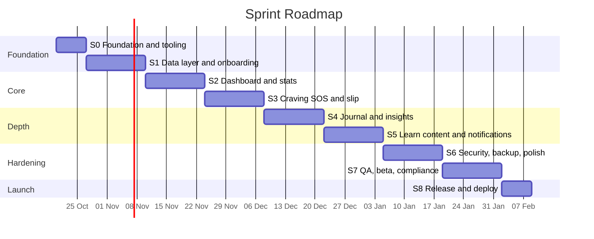
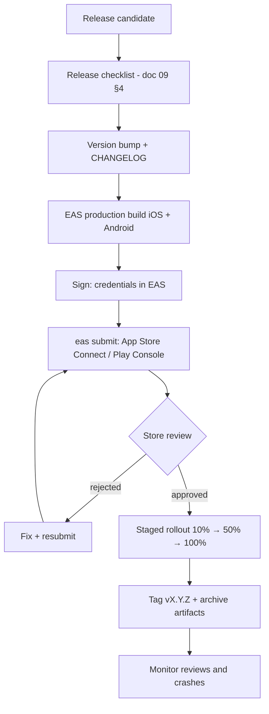
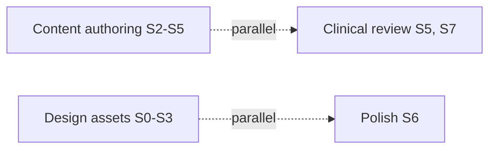

# 10 — Sprint-wise Roadmap & Checklists (Foundation → Deployment)

**Cadence:** 2-week sprints (Sprint 0 = 1 week) · **Team assumption:** 1–2 developers + part-time content/clinical reviewer · **Start:** 2026-10-20 · **Total:** ~16 weeks to store release.
Requirement IDs refer to [08-srs-and-traceability.md](08-srs-and-traceability.md). Tick boxes as work completes.

## Overview

| Sprint | Theme | Key outcome | Reqs |
|---|---|---|---|
| S0 | Foundation | Project boots, tooling, CI, theme | NFR-MNT |
| S1 | Data + Onboarding | SQLite, migrations, onboarding wizard | FR-ONB-1..3 |
| S2 | Dashboard | Timer, stats, health timeline, achievements | FR-DSH-1..3, FR-ACH-1 |
| S3 | Craving + Slip | SOS flow, breathing, logging, slip | FR-CRV-1..3, FR-SLP-1 |
| S4 | Journal + Insights | Check-ins, thought records, charts | FR-CHK-1, FR-INS-1 |
| S5 | Learn + Notifications | 30-day path, articles, local reminders | FR-LRN-1, FR-NTF-1 |
| S6 | Security + Backup + Polish | Lock, export/import, delete, a11y, dark mode | FR-SEC-1, FR-DAT-1..2, FR-INF-1 |
| S7 | QA + Beta | Regression, device matrix, clinical sign-off | NFR-* |
| S8 | Release | Store submission, tag, monitoring | — |

---

## Sprint 0 — Foundation & Tooling (1 week)
**Goal:** a clean, buildable, lint-passing skeleton with CI and design tokens.

### Tasks
- [x] Read Expo SDK 58 docs for each module to be used (per AGENTS.md)
- [x] Remove template/demo screens (`explore.tsx`, unused components)
- [x] `npx expo install expo-sqlite expo-notifications expo-haptics expo-local-authentication expo-file-system expo-sharing expo-document-picker`
- [x] Add dev deps: jest, jest-expo, @testing-library/react-native, zod
- [x] Create folders: `src/db`, `src/domain`, `src/hooks`, `src/i18n`, `src/constants`
- [x] Theme tokens (colours, spacing, type, radius) + light/dark provider
- [x] UI primitives: `Button`, `Card`, `Text`, `Screen`
- [x] Configure `app.json`: name, slug, scheme, bundle IDs, icon placeholders, plugins
- [x] Create `eas.json` (development, preview, production)
- [x] ESLint rules + Prettier + `tsc` strict
- [x] CI workflow: lint, tsc, jest on PR
- [x] First development build on Android + iOS simulator
- [x] Add CHANGELOG.md, PR/issue templates, `.github` folder

### Definition of Done
- [x] `npx expo lint`, `npx tsc --noEmit`, `npx expo-doctor`, `npm test` all green
- [x] App launches on a dev build with themed placeholder tabs
- [x] CI runs and passes on a PR

---

## Sprint 1 — Data Layer & Onboarding
**Goal:** persistent DB with migrations, user can complete onboarding.

### Tasks
- [x] `db/client.ts`: open DB, `PRAGMA journal_mode=WAL; foreign_keys=ON`
- [x] `db/migrations.ts` using `PRAGMA user_version`; schema v1 from [03](03-architecture-and-database.md)
- [x] Wrap app in `SQLiteProvider` with `onInit` migration + seed
- [x] Repositories: profile, reasons, triggers, settings
- [x] Seed predefined triggers
- [x] Onboarding routes: welcome → quit date → habits/cost → reasons → triggers → disclaimer
- [x] Form validation (zod) and friendly errors
- [x] Onboarding gate in root `_layout.tsx` (redirect logic)
- [x] i18n scaffold; English strings
- [x] Medical disclaimer screen with acceptance stored
- [x] Unit tests: migrations (fresh + idempotent), repositories (in-memory DB)

### Acceptance checklist
- [x] Fresh install → onboarding → data persisted after app kill
- [x] Cannot finish without ≥ 1 reason
- [x] Future quit date handled
- [x] Works in airplane mode

### Exit
- [x] FR-ONB-1..3 verified · migration tests pass · demo recorded

---

## Sprint 2 — Dashboard, Stats & Achievements
**Goal:** a motivating home screen driven by pure, tested domain logic.

### Tasks
- [x] `domain/stats.ts` with injectable clock (elapsed, cigsAvoided, moneySaved, lifeRegained)
- [x] `domain/milestones.ts` + `domain/healthTimeline.ts`
- [x] Seed milestones + quotes + tips content
- [x] `useTicker` (focus-aware) and `useStats` hooks
- [ ] Home: timer ring, 3 stat tiles, next milestone, daily quote
- [ ] Progress tab: health timeline stepper, badges grid
- [ ] Achievements repo + idempotent unlock + celebration animation (reanimated)
- [ ] Goals/rewards: create goal, progress bar
- [ ] Settings: edit profile
- [ ] Table-driven tests TC-001..006, TC-013

### Acceptance checklist
- [ ] Timer correct after backgrounding and device reboot
- [ ] Stats match formulas in doc 08 §4
- [ ] Badges unlock exactly once
- [ ] No frame drops (≥ 55 fps) on low-end Android

### Exit
- [ ] FR-DSH-1..3, FR-ACH-1 verified

---

## Sprint 3 — Craving SOS & Slip Support
**Goal:** the core "in the moment" value.

### Tasks
- [ ] Craving modal route; floating SOS button on Home
- [ ] Intensity-before input, reasons carousel
- [ ] Urge-surfing timer (5–10 min) with rotating prompts
- [ ] Breathing exercise (box / 4-7-8) with reanimated circle + haptics
- [ ] Distraction tools: 4Ds checklist, 5-4-3-2-1 grounding
- [ ] Outcome logging (resisted / smoked / abandoned), trigger, intensity-after
- [ ] Craving repo + "cravings resisted" achievements
- [ ] Slip flow: compassionate copy, trigger, reflection, reset option
- [ ] Slip service transaction; preserve lifetime stats; reschedule hooks (stub)
- [ ] Support contacts (add/call) — P2 optional
- [ ] Reduce-motion support; haptics settings toggle
- [ ] Tests TC-007; Maestro flow: craving resisted; slip

### Acceptance checklist
- [ ] SOS reachable in ≤ 2 taps (FR-CRV-1)
- [ ] App killed mid-craving does not corrupt data
- [ ] Slip keeps lifetime days (Gherkin in doc 08)
- [ ] Screen-reader announces phase changes politely

### Exit
- [ ] FR-CRV-1..3, FR-SLP-1 verified · **Internal alpha build #1**

---

## Sprint 4 — Journal & Insights
### Tasks
- [ ] Daily check-in (mood, stress, confidence, sleep, note) — upsert per local day
- [ ] Thought record (situation → thought → emotion → reframe, belief before/after)
- [ ] Journal history list + detail + edit/delete
- [ ] `domain/insights.ts`: hour/weekday heatmap, top triggers, mood trend
- [ ] Charts (lightweight custom SVG/View; avoid heavy libs) with text summaries
- [ ] Empty states for new users
- [ ] Tests TC-010; insights unit tests

### Acceptance checklist
- [ ] One check-in/day enforced
- [ ] Charts render with 0, 1, and 1000 records within budget
- [ ] Charts have accessible text alternative

### Exit
- [ ] FR-CHK-1, FR-INS-1 verified

---

## Sprint 5 — Learn Content & Notifications
### Tasks
- [ ] Content schema validator script (doc 09 §2) wired into CI
- [ ] Author/seed: 120 quotes, 60 tips, 30 lessons, 20 articles, 12 exercises, 15 slip messages
- [ ] Learn tab: today's lesson, 30-day path, categories, search, bookmarks
- [ ] Lesson completion tracking
- [ ] Notifications: permission flow, milestone scheduling, daily check-in reminder, quiet hours, cap 3/day
- [ ] Reschedule on profile edit / slip / import
- [ ] Clinical review round 1 of content
- [ ] Tests: scheduling logic (pure function), content validation

### Acceptance checklist
- [ ] Every content item has `source` and review metadata
- [ ] Notifications fire with app closed, none when opted out
- [ ] Notification text is safe on lock screen

### Exit
- [ ] FR-LRN-1, FR-NTF-1 verified · **Internal alpha build #2**

---

## Sprint 6 — Security, Backup & Polish
### Tasks
- [ ] Biometric/PIN lock (`expo-local-authentication`), lock on background timeout
- [ ] Export JSON (versioned) via share sheet; import with zod validation + confirm overwrite
- [ ] Delete-all-data flow (double confirm)
- [ ] Resources screen: quitlines (verified numbers), sources, disclaimer, licences
- [ ] Dark mode audit; dynamic type up to 200%
- [ ] Animation and haptics polish; empty/error states
- [ ] Performance pass: startup profiling, list virtualisation, bundle size check (`npx expo export`)
- [ ] App icon, adaptive icon, splash; brand finalisation
- [ ] Android `allowBackup` decision documented in `app.json`
- [ ] Tests TC-011, TC-012

### Acceptance checklist
- [ ] Import of malformed file changes nothing
- [ ] Export → delete → import round-trips all data
- [ ] Cold start < 2 s mid-range Android; install < 25 MB
- [ ] No network permission present in built manifest

### Exit
- [ ] FR-SEC-1, FR-DAT-1..2, FR-INF-1 verified

---

## Sprint 7 — QA, Beta & Compliance
### Tasks
- [ ] Full regression: all TC-001..015 + Maestro suite
- [ ] Device matrix run (low-end Android, iPhone SE, tablet)
- [ ] Accessibility audit (VoiceOver/TalkBack, contrast, 200% text)
- [ ] Airplane-mode full pass (NFR-OFF-1)
- [ ] Final clinical content sign-off; verify all statistics & numbers
- [ ] Privacy policy, accessibility statement, terms hosted (static page)
- [ ] Store assets: 6 screenshots per size, description, keywords, preview video
- [ ] EAS `preview` build → TestFlight + Play internal track (5–20 testers)
- [ ] Collect feedback; fix S1/S2 bugs; bug bash
- [ ] Upgrade-path test (install previous build → update → data intact, NFR-REL-2)

### Exit criteria
- [ ] 0 open S1/S2 bugs · crash-free > 99.5% in beta · all NFRs verified · sign-offs recorded

---

## Sprint 8 — Release & Deployment (1 week)

### Deployment checklist
**Accounts & credentials**
- [ ] Apple Developer + Google Play Console accounts active
- [ ] Bundle ID / package name final; EAS credentials generated and backed up
- [ ] Upload keystore stored securely (EAS-managed or offline vault)

**Build**
- [ ] `app.json` version, `ios.buildNumber`, `android.versionCode` bumped
- [ ] `runtimeVersion` policy set; `eas.json` production profile verified
- [ ] `npx expo-doctor` clean; all gates green on `main`
- [ ] Production build installed and smoke-tested on real devices

**Store listing**
- [ ] Title, subtitle, description, keywords, category (Health & Fitness)
- [ ] Screenshots, icon, feature graphic
- [ ] Privacy labels: "Data Not Collected"; Play Data Safety form completed
- [ ] Age rating questionnaire (tobacco references) completed
- [ ] Support URL, privacy policy URL, contact email
- [ ] Health-app declarations (no diagnosis/treatment claims)

**Go-live**
- [ ] Submit via `npx eas-cli@latest submit`
- [ ] Staged rollout enabled (Play) / phased release (iOS)
- [ ] Git tag + GitHub release notes
- [ ] Post-launch monitoring: ratings, crash reports (store consoles), support inbox

**Rollback plan**
- [ ] Halt rollout; ship hotfix via `eas update` only if JS-only and DB-safe; otherwise expedited build
- [ ] Never ship destructive migrations without export prompt

---

## Post-Launch (Backlog, Sprint 9+)
- [ ] Home-screen widgets · [ ] Localisation (Sinhala, Tamil, Hindi, Spanish) · [ ] Gradual-reduction mode (A5) · [ ] Share cards · [ ] Health Connect/Apple Health (opt-in) · [ ] Encrypted backup · [ ] Quarterly content refresh

## Sprint Ceremonies
| Ceremony | When | Output |
|---|---|---|
| Planning | Day 1 | Committed scope tied to FR IDs |
| Daily stand-up | Daily, 10 min | Blockers |
| Review/Demo | Last day | Recorded demo, acceptance sign-off |
| Retrospective | Last day | 3 actions logged |
| Backlog refinement | Mid-sprint | Ready stories (DoR in doc 07) |

## Velocity & Risk Buffer
Plan at ~70% capacity; Sprint 7 carries a 20% bug-fix buffer; content authoring (S5) can start in parallel from S2 to de-risk clinical review lead time.

